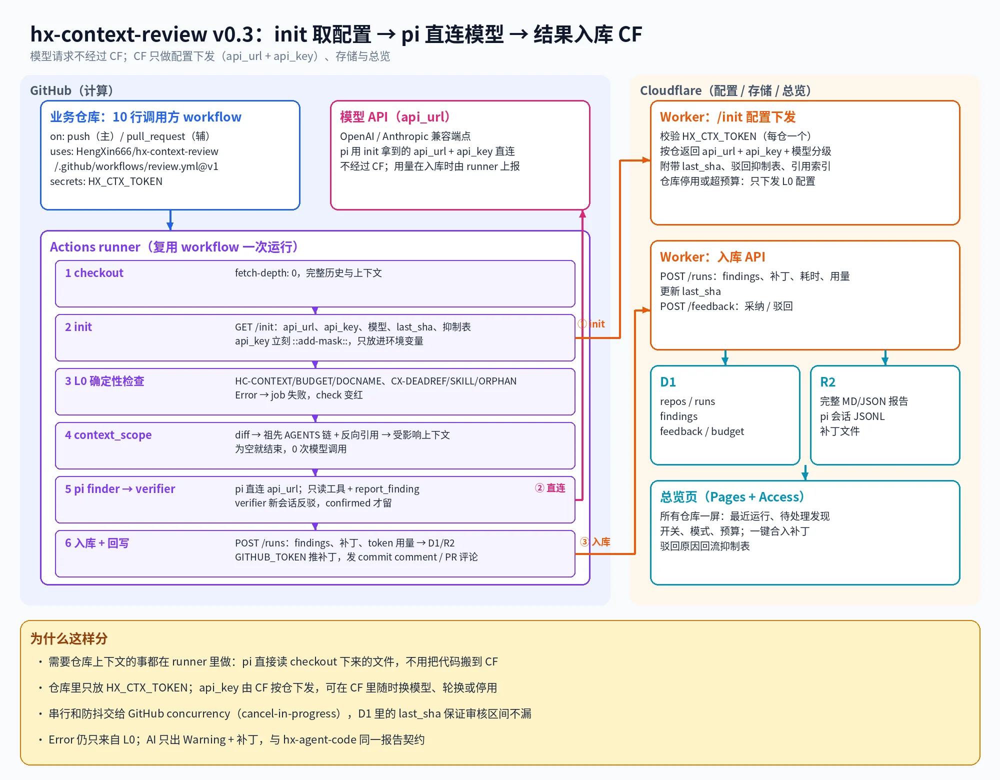

# HX-AI-Review (hx-context-review)

AI 上下文 review: 在业务仓库每次 push / PR 时, 检查 AGENTS.md, README.md, SKILL.md 与 docs 这些 "给 Agent 读的上下文" 是否仍与代码一致. 当前版本 v0.3.



一句话流程: init 取配置 -> pi 直连模型 -> 结果入库 CF. 模型请求不经过 Cloudflare; CF 只做配置下发 (api_url + api_key), 存储 (D1/R2) 与总览页 (Pages + Access).

## 目录

| 路径 | 作用 |
|---|---|
| [context-cr/](context-cr/README.md) | GitHub runner 侧: L0 确定性检查, context_scope, pi finder -> verifier, 入库与回写 |
| [cf-admin/](cf-admin/README.md) | Cloudflare 侧: Worker (/init, /runs, /feedback, /api), D1 schema, R2, 总览 Pages |
| [.github/workflows/review.yml](.github/workflows/review.yml) | 给业务仓库调用的可复用 workflow |
| [docs/architecture/overview.md](docs/architecture/overview.md) | 架构文档 (先读这篇) |
| [docs/reference/report-contract.md](docs/reference/report-contract.md) | 报告契约与规则表, 与 hx-agent-code 同一契约 |
| [docs/reference/api/cf-admin.yaml](docs/reference/api/cf-admin.yaml) | Worker HTTP 契约 (OpenAPI) |
| [docs/tutorials/onboard-repo.md](docs/tutorials/onboard-repo.md) | 业务仓库接入 (10 行调用方 workflow) |
| [docs/tutorials/deploy-cf.md](docs/tutorials/deploy-cf.md) | 部署 Worker, D1, R2, Pages 与 Access |
| [docs/decisions/2026-10-11-pi-runner-direct-model.md](docs/decisions/2026-10-11-pi-runner-direct-model.md) | 为什么 pi 在 runner 直连模型, CF 只管配置与存储 |
| [docs/reference/quality/inventory.md](docs/reference/quality/inventory.md) | hx-agent-code 门禁安装清单与未完成项 |

## 业务仓库接入 (摘要)

```yaml
name: context-review
on:
    push:
        branches: [main]
    pull_request:
jobs:
    review:
        uses: HengXin666/HX-AI-Review/.github/workflows/review.yml@v1
        with:
            endpoint: https://review.example.com
        secrets:
            HX_CTX_TOKEN: ${{ secrets.HX_CTX_TOKEN }}
```

完整步骤见 [docs/tutorials/onboard-repo.md](docs/tutorials/onboard-repo.md).

## 开发

需要 Node 22.19+ 与 pnpm (版本见 package.json 的 packageManager).

```sh
pnpm install --frozen-lockfile
pnpm typecheck
pnpm test
pnpm l0            # 用本工具检查本仓库自己的上下文
pnpm quality:docs  # hx-agent-code 文档门禁
```

贡献流程见 [CONTRIBUTING.md](CONTRIBUTING.md).
