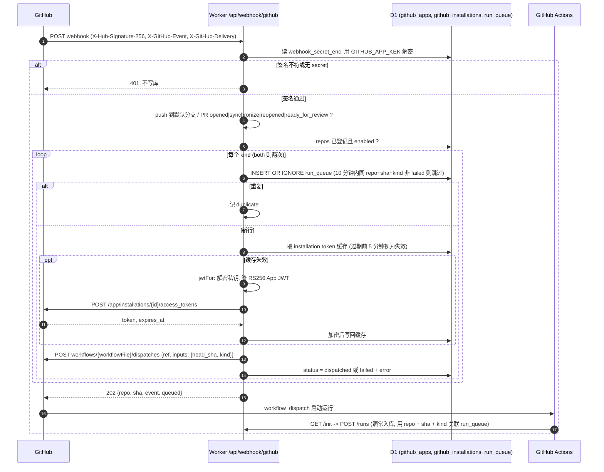

# GitHub App 与 webhook 触发

除了业务仓库里的调用方 workflow 自己按 push / PR 触发, hx-context-review 也可以注册一个 GitHub App: Worker 收到 App 的 webhook 后写入 `run_queue`, 再用 installation token 调 `workflow_dispatch` 启动审查. 代码在 [cf-admin/worker/github/](../../cf-admin/worker/github/routes.ts) 与 [routes/webhook.ts](../../cf-admin/worker/routes/webhook.ts), 表结构在 [migrations/0007_github_app.sql](../../cf-admin/migrations/0007_github_app.sql) 与 [0008_app_manifest.sql](../../cf-admin/migrations/0008_app_manifest.sql), HTTP 契约见 [cf-admin.yaml](../reference/api/cf-admin.yaml) 的 `/api/github/*` 与 `/api/webhook/github`. 总体位置见 [overview.md](overview.md#webhook-触发).

## App 注册

推荐走下一节的一键连接; 下面是手工注册的步骤, 两条路存进同一行 `github_apps`.

1. 在 GitHub 新建一个 App, Webhook URL 填 `GET /api/github/app` 返回的 `webhookUrl` (`<Worker>/api/webhook/github`), 设置一个至少 16 字符的 webhook secret, 下载私钥.
2. 权限 (与一键连接的 manifest 相同):
    - Actions: write: 调 `workflow_dispatch` 启动审查.
    - Contents: write: 发 commit comment (push 运行的评论挂在提交上), 以及一键启用时经 contents API 提交工作流文件.
    - Workflows: write: GitHub 要求凡是改动 `.github/workflows/` 下的文件都另需此权限, 一键启用写 `hx-context-review.yml` 靠它.
    - Secrets: write: 一键启用写仓库的 actions secret `HX_CTX_TOKEN`, 以及读取仓库 public key 与探测 secret 是否存在.
    - Pull requests: write, Issues: write: PR 评论.
    - Metadata: read: GitHub 对所有 App 的强制项.

    订阅事件: push, pull_request, installation, installation_repositories. 只做手工注册且不用一键启用时, Contents 的写只为 commit comment, Workflows 与 Secrets 可以不给.
3. 在 Worker 上设置 secret `GITHUB_APP_KEK` (任意高熵字符串). 未设置时保存与读取 App 配置一律 400, 不会退化为明文.
4. 管理员在总览页 `POST /api/github/app`: `appId`, `slug`, `privateKey` (GitHub 下载的 `BEGIN RSA PRIVATE KEY` 原样即可, 会自动包成 PKCS#8; 也接受 `BEGIN PRIVATE KEY`), `webhookSecret`, 可选 `clientId`, `clientSecret`, `workflowFile` (默认 `hx-context-review.yml`). 私钥在保存前就用 WebCrypto 导入一次, 导不进来直接 400.
5. `POST /api/github/app/verify` 用存储的私钥签 App JWT, 真调 GitHub `GET /app` 与 `GET /app/installations`: 成功 `status = verified`; 凭据被拒或私钥属于别的 App 返回 422, 权限不足返回 403, 两者都把 `status` 置为 `invalid`.
6. 把 App 安装到业务仓库. `GET /api/github/installations` 列出每个安装能看到的仓库, 以及它们是否已在 repos 表登记 (`registered`, `kind`), 前端据此提示 "已安装但未登记".

## 一键连接

不用手抄 App id 与私钥, 由 GitHub 的 [App Manifest flow](https://docs.github.com/apps/sharing-github-apps/registering-a-github-app-from-a-manifest) 建 App 并把凭据直接交给 Worker. 代码在 [github/connect.ts](../../cf-admin/worker/github/connect.ts), 由 `handleGitHub` 挂在 `/api/github/*` 下.

1. 前端调 `GET /api/github/app/manifest` (admin). Worker 生成一次性 `state` (24 字节随机, base64url, 存 `github_app_states`, 10 分钟有效, 顺带清掉 1 天前的旧行) 和 manifest: 名字 `hx-context-review-<6 位 hex>`, `url` 为请求自身的 origin, webhook 指向 `<origin>/api/webhook/github`, `redirect_url` 为 `<origin>/api/github/app/callback`, 私有 App, 权限与事件见上一节.
2. 前端用整页表单 POST 到 `https://github.com/settings/apps/new?state=<state>`, 隐藏字段 `manifest` = manifest 的 JSON. 必须整页跳转, 不能 fetch: 用户要在 GitHub 页面上确认创建.
3. GitHub 建好 App 后把浏览器 302 到 `/api/github/app/callback?code=&state=`. 这是 `/api/github/*` 下唯一不走 `requireAdmin` 的接口: 浏览器从 GitHub 回来时不一定带着 Access 身份, 一次性 state 证明流程是管理员发起的. state 用单条 `UPDATE ... WHERE used = 0 AND created_at > now - 10min` 消费, 并发两个回调只有一个能赢.
4. state 缺失, 不存在, 过期或已用: 400 JSON, 不调 GitHub, 不写库. 之后的结果一律 302 回总览页, 不返回 JSON:
    - 成功: `#/github?connected=1&slug=<slug>`, 前端据此引导去 `https://github.com/apps/<slug>/installations/new` 安装.
    - 失败: `#/github?error=<reason>`. `kek_missing` 在花掉 code **之前**检查 (否则 App 建出来了私钥却无处可存); `conversion_failed` 是 `POST /app-manifests/{code}/conversions` 被拒 (code 1 小时有效, 只能用一次); `incomplete_credentials` 是返回里缺 pem 或 webhook_secret; `save_failed` 是私钥导入或写库失败.
5. 成功时后端用 code 换回 `id`, `slug`, `pem`, `webhook_secret`, `client_id`, `client_secret`, 先用 WebCrypto 导入一次私钥, 再走与 `POST /api/github/app` 相同的 `saveApp`: 按下文信封加密入库, `status = configured`.

已知限制: manifest 的 `action` 固定是个人账号的 `https://github.com/settings/apps/new`. 要把 App 建在组织下, 地址应为 `https://github.com/organizations/<org>/settings/apps/new`, 后端暂不支持传入组织; 组织场景先用上一节的手工注册.

## 一键启用仓库

安装 App 后, 前端用 `GET /api/github/installations` 拿 `installationId`, 再用 `GET /api/github/repos?installationId=<n>` 列出该安装的仓库 (第一页, 最多 100 个): 每行带 repos 表里的登记状态 (`registered`, `kind`, `enabled`), 以及两项探测 `workflowInstalled` (`.github/workflows/<workflow_file>` 是否存在) 与 `secretInstalled` (`HX_CTX_TOKEN` 是否存在, 只看名字). 探测失败一律按 false, 不拖垮整张列表.

`POST /api/github/enable {fullName, kind, installationId}` (admin) 依次跑三步. 每步各自 try/catch, 独立成败, 前一步失败后一步照跑; 响应总是 200, `ok` 只在三步都成功时为 true, `steps` 固定三项, 失败项的 `message` 是 GitHub 的错误原文 (至多 300 字):

1. workflow: 读默认分支, 取模板 (Worker 运行时从 v1 tag 拉 [templates/hx-context-review.workflow.yml](../../templates/hx-context-review.workflow.yml), 拉不到用内置兜底), 渲染后经 contents API 写 `.github/workflows/hx-context-review.yml`, 提交信息 `chore: enable hx-context-review`; 文件已存在则带 sha 覆盖.
2. secret: 生成新的 runner token (`hxctx_` 前缀), 取仓库的 actions public key, 用 libsodium sealed box (纯 TS 实现, [sealbox.ts](../../cf-admin/worker/github/sealbox.ts)) 封装后写 actions secret `HX_CTX_TOKEN`.
3. register: 新仓库按 `kind` 登记并启用, 存 token 的 SHA-256; 已登记仓库更新 `kind` 并置 `enabled`, 只有第 2 步成功才轮换 token hash, 否则仓库里已有的 secret 会立刻失效.

installation token 换不到时 1, 2 两步都记失败, 第 3 步照常执行. 新仓库登记成功而 secret 没写进去时, 响应额外带 `manualSecret: {name: "HX_CTX_TOKEN", value}`: 明文只出现这一次, 让管理员到仓库 Settings 的 Secrets 里手动配置.

`POST /api/github/disable {fullName}` 只把 `repos.enabled` 置 false (未登记 404), 工作流文件与 secret 留在仓库里; webhook 对停用的仓库不再 dispatch, /init 只下发 L0 配置.

## 保存与状态

每次保存都把 `status` 重置为 `configured`; `appId` 变化时清空所有缓存的 installation token, 因为它们属于旧 App. App 配置只有一行 (`github_apps.id = 1`).

## 私钥信封加密

- KEK: Worker secret `GITHUB_APP_KEK` 经 SHA-256 派生出 AES-256 密钥.
- 每个值单独生成随机 256-bit 数据密钥, AES-GCM 加密值, 再用 KEK AES-GCM 加密数据密钥, 存为 `v1.<wrapIv>.<wrappedKey>.<iv>.<ct>`.
- 这样存的有: 私钥, client secret, webhook secret, 缓存的 installation token. 不写 R2, 不打日志; 管理接口只返回 `hasPrivateKey`, `hasClientSecret`, `hasWebhookSecret`.
- 解密时机最小化: 私钥只在 `tokens.ts` 的 `jwtFor` 里解密, 签完 JWT 即丢; webhook secret 只在验签时解密; token 只在取缓存时解密. KEK 错误或密文被篡改时直接抛错, 不返回垃圾.
- App JWT 用 RS256, `iat` 回拨 60 s 防时钟偏差, `exp` 为 9 分钟后 (GitHub 上限 10 分钟).

## installation token 缓存

installation token 缓存在 D1 的 `github_installations` 行上 (兼做安装状态表, 所以没有单独的 token 表), 同样信封加密. 取用时若距 `expires_at` 不足 5 分钟 (`TOKEN_EARLY_EXPIRY_MS`) 就视为失效, 用新签的 App JWT 换一个新 token 并写回缓存; 否则直接复用, 不打 GitHub. 安装被删除, 挂起或 App 换了 `appId` 时清空缓存.

## webhook 验签

`POST /api/webhook/github` 不走 `requireAdmin`, 验签本身就是鉴权, 必须在通用 `/api/*` 分发之前匹配:

1. 读取原始请求体 (验签必须基于原始字节, 不能先解析再序列化).
2. 用 KEK 解出 webhook secret; 没有 secret 或没有 KEK 时返回 401 (无法验签), 不写库.
3. 计算 HMAC-SHA256 与 `X-Hub-Signature-256` 比较, 不一致返回 401 `invalid X-Hub-Signature-256`, 不写库.
4. 验签通过后才解析 JSON (失败 400), 按 `X-GitHub-Event` 分派; `X-GitHub-Delivery` 记入 `run_queue.delivery_id`.

处理的事件: `ping` (200 `{pong: true}`), `push`, `pull_request`, `installation` (created, deleted, suspend, unsuspend, new_permissions_accepted), `installation_repositories` (added / removed). 其他事件 202 `{ignored}`.

## 触发条件

- push: 只认 `ref == refs/heads/<repository.default_branch>`; 分支删除 (`deleted` 或 `after` 全 0) 忽略.
- pull_request: 只认 opened, synchronize, reopened, ready_for_review; 跳过 draft 与来自 fork 的 PR.
- 仓库必须已在 repos 表登记且 `enabled`; 否则 202 `{ignored}`.
- 按仓库 kind 排队: `context` 或 `code` 一行, `both` 每种各一行, 各 dispatch 一次.
- dispatch: `POST /repos/{repo}/actions/workflows/{workflowFile}/dispatches`, body `{ref, inputs: {head_sha, kind}}`. 成功标 `dispatched`; 失败标 `failed` 并记录原因 (例如 `422 Workflow does not have 'workflow_dispatch' trigger`), 整体仍返回 202 与每条结果, 不 500.
- 被审仓库的调用方 workflow 需要声明 `workflow_dispatch` 并接收 `head_sha` 与 `kind` 输入, 再把 `head_sha` 传给 review.yml 的同名 input. review.yml 的 checkout 按 `inputs.head_sha || github.event.pull_request.head.sha || github.sha` 取提交, 所以传下来的 `head_sha` 会被真正 checkout 并在其上评审 (push 是推送后的提交, PR 是 PR 头). 调用方没传时退回旧行为: dispatch 审被 dispatch 的 ref (默认分支) 的 HEAD. 一键启用的内置兜底模板与 [templates/hx-context-review.workflow.yml](../../templates/hx-context-review.workflow.yml) 都传 `head_sha`, 两者内容等价.
- `head_sha` 来自 dispatch 的调用方 (对仓库有写权限的人或 App), 按不可信输入处理. checkout 一个 sha 不会执行它: review.yml 只跑从 HX-AI-Review 按 `tool-ref` checkout 的工具, 不跑被审树里的脚本或 workflow, 模型也只用只读工具读它; `head_sha` 只进 `with.ref`, 不拼进 shell. 安全边界不变.

## 触发路径

业务仓库可以同时有三条路触发审查. 它们最终都 `uses` 同一个 [review.yml](../../.github/workflows/review.yml), 只是谁发起, 审哪个提交不同:

| 路径 | 谁发起 | 审哪个提交 | 作用 |
|---|---|---|---|
| push 到默认分支 | 业务仓库自带的调用方 workflow | push 后的默认分支 HEAD (`github.sha`) | 主线每次提交都审, 推进 last_sha |
| pull_request | 业务仓库自带的调用方 workflow | PR 头 (`pull_request.head.sha`) | 在 PR 上出评论, 不推进 last_sha |
| webhook + workflow_dispatch | Worker 收到 App webhook 后 dispatch | 调用方传下 `head_sha` 时就是它; 没传时是被 dispatch 的 ref (默认分支) 的 HEAD | 一键启用后的仓库由 Worker 侧主动触发, 可在 run_queue 里追踪 |

为什么不冲突:

- 三条路走同一个 review.yml, 由它 job 内部的 concurrency (`hx-context-review-<kind>-<repo>-<PR 号或 ref>`, `cancel-in-progress: true`) 串行化. 同一个默认分支 push 同时被调用方 push 触发与 webhook dispatch 时, 两次运行 group 相同, 后到的取消先到的, 同一个 HEAD 只审完一次; 预算预留也在同组内接管, 不会重复占额度.
- 调用方 workflow 不再定义自己的 concurrency, 否则外层 group 会先于 review.yml 的 group 取消运行.
- last_sha 是按仓按 kind 的游标, 每次完整的 push 运行审 `last_sha..HEAD` 整段区间. 被取消或中途 push 跳过的提交会落进下一次运行的区间, 所以区间不漏.
- PR 事件的 webhook dispatch 没有 PR 上下文 (事件是 `workflow_dispatch`, 不推进 last_sha), group 落在默认分支 ref 上. 传了 `head_sha` 时它审 PR 头, 但仍与主线 push 运行同组, 两者会互相取消 (已知限制; 主线被取消的提交会落进下一次 push 运行的区间, 不漏审). PR 上的评论只靠 `pull_request` 路径. 只装 App 不放调用方 workflow 的仓库, 无法 dispatch (422), 所以模板必须先落盘.

## 10 分钟去重窗口

GitHub 可能重复投递同一事件, 并发投递也会同时到达. `run_queue` 的写入是一条 `INSERT OR IGNORE ... SELECT ... WHERE NOT EXISTS` 语句: 同 repo + sha + kind 在 10 分钟内 (`DEDUP_WINDOW_MS`) 已有 `status != failed` 的行就不插入, 该 kind 返回 `duplicate`. 单条语句在 D1 中原子, 所以并发投递不会双触发. `failed` 行不参与去重, GitHub 后台的 Redeliver 可以重试一次失败的触发; 超过窗口后同一 sha 可再次触发.

## 时序

## 数据

| 表 | 粒度 | 内容 |
|---|---|---|
| github_apps | 单行 (id = 1) | app_id, slug, client_id, workflow_file, status, 加密的私钥 / client secret / webhook secret, installed_at |
| github_installations | 每个安装一行 | 账号, 类型, repository_selection, 状态, 仓库列表, 加密的 installation token 与过期时间 |
| github_app_states | 每次 GET /api/github/app/manifest 一行 | 一次性 state, created_at, used; 10 分钟有效, 一天后清理 |
| run_queue | 每次触发每个 kind 一行 | repo, sha, kind, event, ref, pr_number, installation_id, delivery_id, status (pending / dispatched / failed), error |

这几张表按变化节奏拆分 (github_app_states 只服务一键连接): App 由管理员改, 安装由 installation webhook 改, 队列由 push / PR webhook 写. 管理端查询队列用 `GET /api/github/queue?repo=&limit=` (limit 1..200, 默认 50).
