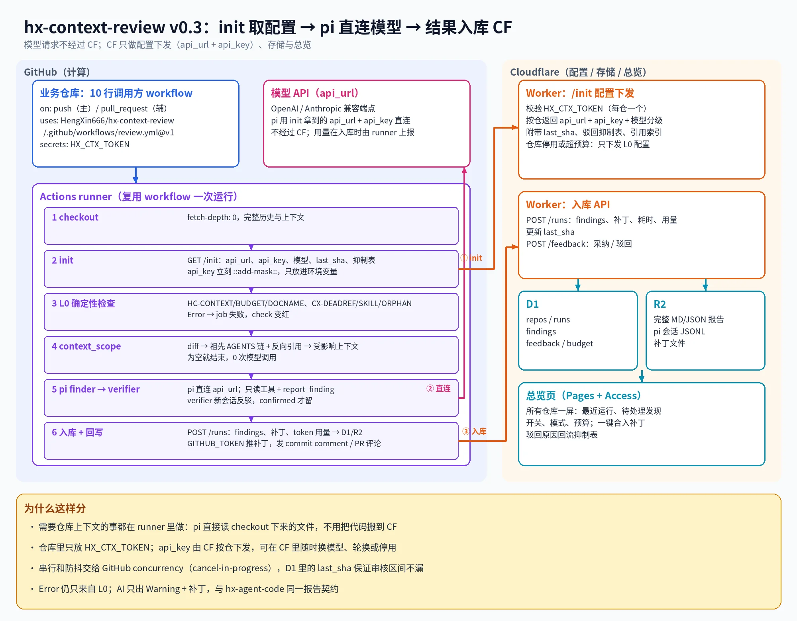

# hx-context-review v0.3 架构

init 取配置 -> pi 直连模型 -> 结果入库 CF. 模型请求不经过 CF; CF 只做配置下发 (api_url + api_key), 存储 (D1/R2) 与总览页 (Pages + Access).

一次运行跑一种 CR: context CR 审上下文文件是否还和代码一致, code CR 审 diff 本身. 两者共用同一条流水线与同一份报告契约, 只在 scope, 提示词, 规则命名空间与产物上分叉.



## 要解决的问题

业务仓库里的 AGENTS.md, README.md, SKILL.md 与 docs 是 Agent 的 "事实来源". 代码一改, 这些文件很容易悄悄过时: 路径改名了, 命令换了, 模块边界变了, 但上下文还在描述旧世界. hx-context-review 在每次 push / PR 时回答两个问题:

- context CR: 这次 diff 让哪些上下文变成了错的?
- code CR: 这次 diff 新增或修改的行里, 哪些是错的? (逻辑错误, 边界条件, 错误处理, 并发与资源, 安全边界, 与既有设计相悖)

一个仓库可以只跑一种, 也可以两种都跑. 两者共享 budget, provider, 模型分级, 提示词附录与驳回抑制表, 所以不拆成两个服务; 原因见 [双模式决策](../decisions/2026-10-25-dual-cr-kind.md).

## 组件

```
GitHub (计算)                                       Cloudflare (配置 / 存储 / 总览)
+------------------------------+                    +-----------------------------+
| 业务仓库: 10 行调用方 workflow |                    | Worker /init  配置下发        |
| uses: .../review.yml@v1      |   (1) GET /init     |  校验 HX_CTX_TOKEN            |
| secrets: HX_CTX_TOKEN        | -----------------> |  按仓返回 api_url + api_key   |
+--------------+---------------+                    |  + 模型分级 + last_sha + 抑制表 |
               v                                    +-----------------------------+
+------------------------------+                    | Worker 入库 API               |
| Actions runner (一次运行)     |   (3) POST /runs    |  POST /runs  POST /feedback   |
| 1 checkout fetch-depth 0     | -----------------> |  更新 last_sha 与预算          |
| 2 init  (mask api_key)       |                    +------+--------------+-------+
| 3 L0 (仅 context, Error)     |                           v              v
| 4 scope (context/code)       |                    +-----------+  +--------------+
| 5 pi finder -> verifier ------+--(2) 直连 api_url   | D1 rows   |  | R2 报告/会话   |
| 6 入库 + 回写                 |       |             +-----------+  | /补丁          |
+------------------------------+       v             总览页 Pages + Access         |
                              模型 API (OpenAI / Anthropic 兼容)
```

| 组件 | 代码 | 职责 |
|---|---|---|
| 调用方 workflow | 业务仓库 `.github/workflows/*.yml` | 约 10 行, 只声明触发事件, 引用可复用 workflow, 传 HX_CTX_TOKEN |
| 可复用 workflow | [.github/workflows/review.yml](../../.github/workflows/review.yml) | 6 个步骤, 3 个输入 (`endpoint`, `tool-ref`, `kind`), concurrency 串行与防抖, 权限 contents/pull-requests write |
| runner CLI | [context-cr/](../../context-cr/README.md) | init, l0, rules, scope, review, publish 六个流水线子命令 (另有 local, test, run); scope 与 review 按 kind 分派 |
| 配置与入库 Worker | [cf-admin/worker/](../../cf-admin/worker/index.ts) | /init, /spend, /runs, /feedback, /api/*; 按 kind 过滤运行, 发现与规则聚合; /api/live 实时通道 (Durable Object `RealtimeHub`), /api/github/* 与 /api/webhook/github (GitHub App 触发) |
| 存储 | D1 + R2 | D1: repos, runs, findings (三者都带 kind), feedback, budget, suppressions; R2: MD/JSON 报告, pi 会话 JSONL, 补丁 |
| 总览页 | [cf-admin/pages/](../../cf-admin/pages/src/App.tsx) | 部署状态, 仓库登记与开关/模式/kind/预算, provider 管理, 最近运行, 待处理发现, 一键合入补丁, 驳回原因回流, context / code 切换. 构建产物作为 Worker 静态资源一起部署, 与 API 同域 |
| 一键部署 | [.github/workflows/deploy-cf.yml](../../.github/workflows/deploy-cf.yml) | 手动触发: D1 + 迁移, R2, Worker (含总览页静态资源与自定义域名路由), 可选写入模型 key secret |

详细设计: [context-cr.md](context-cr.md) 与 [cf-admin.md](cf-admin.md).

## 一次运行

两种 kind 的差别写在每一步的括号里.

1. checkout: `fetch-depth: 0`, 拿到完整历史, 以便计算 last_sha 到 head 的区间和 merge-base.
2. init: `GET /init?repo=owner/name&kind=context|code&group=<concurrency group>`, Bearer HX_CTX_TOKEN. `kind` 来自调用方 workflow 的输入, 缺省 `context`; 仓库只服务另一种时返回 400. 返回 api_url, api_key, finder/verifier 模型, last_sha, 抑制表. runner 立刻 `::add-mask::` api_key, 写入 RUNNER_TEMP 下权限 0600 的文件, review 步骤读取后立即删除, publish 步骤兜底删除; key 不进 `$GITHUB_ENV`, 因此后续步骤与第三方 Action 看不到它. `init.json` 不含 key. 返回值必须是不含空白与控制字符的单行, 否则 init 失败. 仓库停用, 模式为 l0 或超预算时只下发 L0 配置, 没有 key.
3. L0 确定性检查 (仅 context): HC-CONTEXT, HC-BUDGET, HC-DOCNAME, CX-DEADREF, CX-SKILL, CX-ORPHAN. 新 Error 让 job 失败, check 变红; 但后续步骤照常执行, 结果照常入库. code 运行直接写空的 `l0.json`, 不跑这些规则: 它们判的是上下文, 不是 diff.
4. scope: 按 kind 分派. context 下是区间 diff -> 每个变更路径的祖先 AGENTS 链 + 引用了该路径 (或其所在目录) 的上下文文件 + 改动的 AGENTS 的所有后代 AGENTS; code 下是区间 diff -> 每个文件新增行的 hunk (删除行没有新侧行号, 不可被报). 结果为空就结束, 0 次模型调用.
5. pi finder -> verifier: finder 会话用只读工具 (read, grep, find, ls) 与 `report_finding`. context 下找过时陈述并可附补丁, code 下找新增行的缺陷且工具没有补丁字段; 每个候选在新的 verifier 会话里被尝试反驳, 只有 `confirmed` 才保留, 规则分别为 `CX-AI` 与 `CODE-AI`, 等级都是 Warning. 补丁用 `git apply --check` 确定性校验.
6. 入库 + 回写: POST /runs 发送 kind, findings, 补丁, 耗时, token 用量; 用 GITHUB_TOKEN 把可用补丁推到 `hx-ctx/patch-<sha>` 分支 (仅 context); push 发 commit comment, PR 更新同一条带标记的评论. `last_sha` 只由完整的 context push 运行推进.

## 为什么这样分

- 需要仓库上下文的事都在 runner 里做: pi 直接读 checkout 下来的文件, 不用把代码搬到 CF.
- 仓库里只放 HX_CTX_TOKEN; api_key 由 CF 按仓下发, 可在 CF 里随时换模型, 轮换或停用.
- 串行和防抖交给 GitHub concurrency (cancel-in-progress), D1 里的 last_sha 保证审核区间不漏: 被取消的运行不执行 publish; review 失败时 publish 只把 L0 结果入库并标记 `complete: false`, Worker 不推进 last_sha, 下一次从更早的基点开始.
- Error 仍只来自 L0; AI 只出 Warning + 补丁, 与 hx-agent-code 同一报告契约 ([report-contract.md](../reference/report-contract.md)).
- 两种 CR 同服务而不是拆两个: 共享 budget, provider, 模型分级, 提示词附录与驳回抑制表; 两者的 Error 语义相同 (只来自 L0), 拆开就是重复实现; 总览页需要同时看两种 CR 的健康度. 只加一个 kind 维度, 老客户端不带这个参数时行为不变.
- concurrency group 带上 kind (`hx-context-review-<kind>-<repo>-<ref>`): 同一仓库的 context job 与 code job 互不取消, 各自串行与防抖; 预算是多槽位: 每次运行在 `budget_claims` 里占一行, 额度最多一个单次上限 (`per_run_cap_usd`, 未设时为月预算的 1/4), 同组的新运行接管 (结算) 被 GitHub 取消的旧预留, 不同组各自持有自己的预留并发运行, 直到 "月预算 - 本月花费 - 未结算预留" 不足为止. 两种 CR 争的是同一份月预算. 细节见 [cf-admin.md](cf-admin.md#last_sha-与预算).

决策记录: [2026-10-11-pi-runner-direct-model.md](../decisions/2026-10-11-pi-runner-direct-model.md), [2026-10-25-dual-cr-kind.md](../decisions/2026-10-25-dual-cr-kind.md).

## 实时通道

总览页通过 WebSocket 看到正在跑的运行, 不再只能等 `POST /runs` 入库后刷新. 代码在 [cf-admin/worker/realtime/](../../cf-admin/worker/realtime/index.ts), 接口见 [cf-admin.yaml](../reference/api/cf-admin.yaml) 的 `/api/live` 与 `/api/live/emit`.

- 房间按仓库: 每个 repo 一个 Durable Object `RealtimeHub` 实例 (`idFromName(repo.toLowerCase())`, GitHub 仓库名大小写不敏感), 绑定名 `REALTIME`, SQLite 存储类. 没有这个绑定时两个接口都返回 503, 其余 Worker 功能不受影响.
- 五种事件: `stage` (某阶段 running/done/failed), `log`, `finding`, `progress` (finder 批次, 候选数, verifier 进度), `done` (complete 与计数). 统一信封 `{type, repo, runId, kind, at, payload}`, 字段缺失或非法一律 400, 不静默补默认值 (与 `/runs` 同一规则). 下行事件多一个房间内严格递增的 `id`.
- 生产者: runner 用 `POST /api/live/emit` 带 `Authorization: Bearer HX_CTX_TOKEN`, token 必须属于 `event.repo`; 不带 Bearer 时按管理员登录鉴权. Worker 内部入库路径用 `tryEmitLive` 走 DO RPC, 永不因实时通道失败而影响入库.
- 订阅: `GET /api/live?repo=owner/name[&lastEventId=n]`, `requireAdmin` 鉴权, 带 Origin 时必须同源 (防跨站 WebSocket 劫持). 第一帧是 `snapshot` (活跃 run 表, `lastEventId`, `oldestEventId`, `replayed`, `gap`), 随后补发 `lastEventId` 之后的事件, 再进入实时.
- 200 条环形缓冲: 事件存进 DO storage (不只在内存), 写第 n 条时删第 n-200 条, 所以断线续传最多补 200 条; 落后更多或 id 超前时 `gap: true`, 客户端以 snapshot 为准并从 /api 重新拉历史.
- 心跳: 有连接时 alarm 每 30 s 发 `{"type":"ping"}`, 客户端回 `{"type":"pong"}`; 90 s 没有 pong 的连接以关闭码 4000 "heartbeat timeout" 断开. 用 Hibernation WebSocket API, 空闲连接不计 DO 时长.

## webhook 触发

除了业务仓库自己的调用方 workflow, 也可以安装一个 GitHub App, 由 Worker 收 webhook 后主动触发审查. 设计见 [github-app.md](github-app.md).

1. GitHub 把事件投到 `POST /api/webhook/github`, Worker 先用 webhook secret 校验 `X-Hub-Signature-256`, 不通过 401 且不写库.
2. push 只认默认分支 (`ref == refs/heads/<repository.default_branch>`, 分支删除忽略); pull_request 只认 opened, synchronize, reopened, ready_for_review, 跳过 draft 与 fork.
3. 仓库必须已在 repos 表登记且启用; 按仓库 kind 每种各写一行 `run_queue` (`both` 写两行). 同 repo + sha + kind 在 10 分钟内已有非 failed 行就算重复, 不再触发.
4. 用 installation token 调 `workflow_dispatch` (inputs `head_sha`, `kind`), 成功标 `dispatched`, 失败标 `failed` 并记原因. 之后的运行照常走 `/init` -> `/runs`, 与 run_queue 用 repo + sha + kind 关联.

## 安全边界

| 资产 | 存放 | 暴露面 |
|---|---|---|
| HX_CTX_TOKEN | 业务仓库 secret; D1 只存 SHA-256 | /init, /spend, /runs, /feedback |
| api_key | Worker secret, D1 只存 secret 名 | /init 响应, RUNNER_TEMP 下 0600 文件 (review 读后即删), review 进程内存, 被 mask |
| GITHUB_TOKEN | Actions 自动注入, 只传给 publish 步骤 | 推补丁分支, 评论 |
| HX_CTX_TOKEN | 只传给 init 与 publish 步骤 | /init, /runs |
| 管理权限 | Cloudflare Access | /api/* 校验 Access JWT (RS256, aud, exp), 未配置即 403 |
| GitHub App 私钥, client secret, webhook secret, installation token | D1, 用 Worker secret `GITHUB_APP_KEK` 信封加密 | 私钥只在签 App JWT 时解密; webhook secret 只在验签时解密; 管理接口只返回 has* 标记 |

来自 fork 的 PR (pull_request 与 pull_request_target 都算) 在 job 条件里直接跳过: 它拿不到 secrets, head 提交也不在本仓库, 不能往本仓库推补丁分支. 模型生成的补丁只有在只改动被报告的那个上下文文件时才会推送, 且只可能来自 context 运行.

## 已知限制

- 补丁分支的提交不会触发其他 workflow (GITHUB_TOKEN 的限制), 需要人工开 PR 合入; 总览页提供 compare 链接.
- push 触发建议只开在默认分支, 因为 last_sha 是按仓一个游标; 这个游标只对 context CR 有意义, code CR 既不读也不推进它.
- code CR 只看新增行: 删掉一行校验同样可能引入缺陷, 但删除行在被审的新文件里没有行号, 无法定位报告.
- L0 读的 baseline 来自可信 base 提交, 不信任本次 diff 自己改的 baseline.
- CF 的引用索引是可选提示, runner 每次都会本地重算反向引用.
